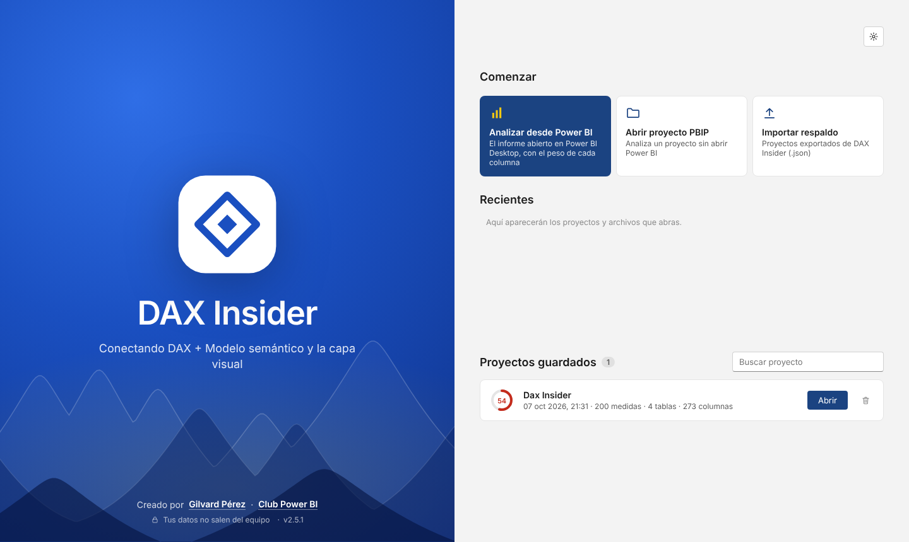
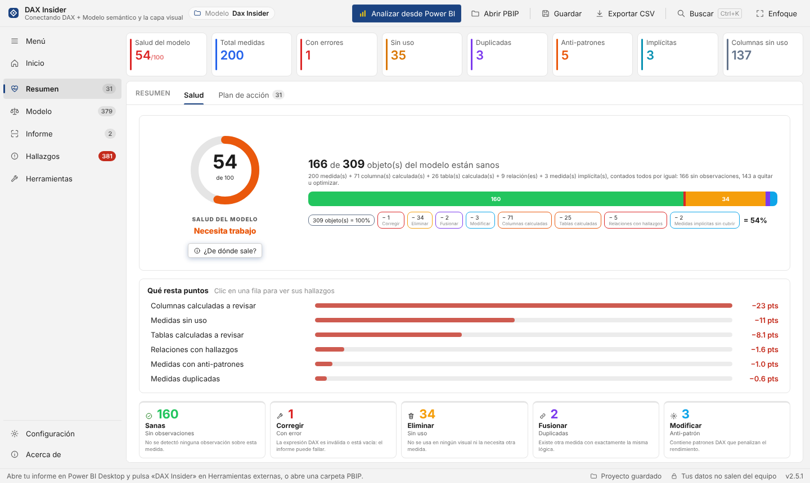
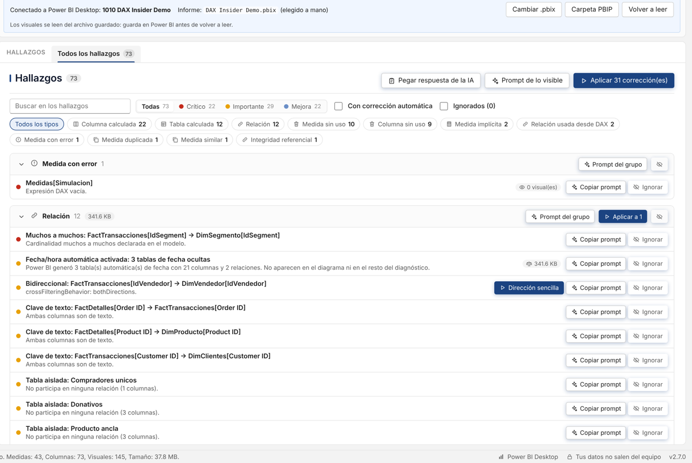
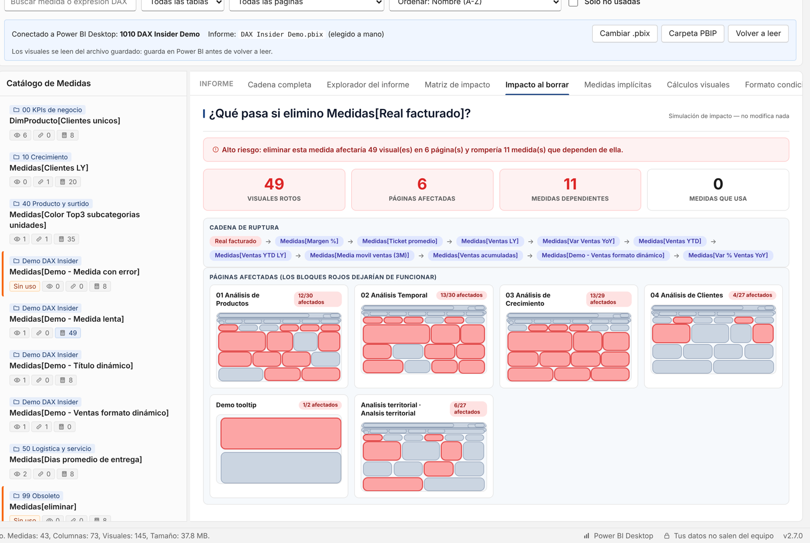

  

<h1 align="center">DAX Insider</h1>

<b>Conectando DAX + Modelo semántico y la capa visual</b>

  <a href="https://github.com/gilvardperez/DaxInsider/releases/latest"><b>⬇ Descargar la última versión</b></a>
  &nbsp;·&nbsp; Windows 10/11 (64 bits) &nbsp;·&nbsp; Portable, sin instalar

---

DAX Insider revisa tu modelo de Power BI de punta a punta: las medidas DAX, el modelo semántico y los visuales del informe. Te dice qué conviene corregir, por qué y qué se rompe si lo cambias. Además, puede aplicar las correcciones directamente en Power BI Desktop.

## Descarga

1. Entra a **[Releases](https://github.com/gilvardperez/DaxInsider/releases/latest)** y descarga `DAX-Insider-x.y.z-portable.zip`.
2. Descomprímelo en una carpeta tuya (por ejemplo, Documentos).
3. Doble clic en **DAX Insider.exe**. No hay que instalar nada ni crear una cuenta.

> **Aviso de Windows:** el .exe no tiene firma digital, así que la primera vez SmartScreen puede mostrar «Windows protegió su PC». Pulsa **Más información** y luego **Ejecutar de todas formas**.

Para analizar un informe abierto, abre tu .pbix o .pbip en **Power BI Desktop** y entra a **Herramientas externas › DAX Insider**. La primera vez, la app te ofrece registrar ese botón. Sin Power BI abierto, usa **Abrir PBIP**.

## Qué hace

| Sección | Qué encuentras |
|---|---|
| **Resumen** | Salud del modelo explicada punto por punto y un plan de acción ordenado por impacto y esfuerzo. |
| **Modelo** | Peso (VertiPaq), relaciones, medidas, duplicadas y similares, linaje, objetos calculados, columnas sin uso y seguridad. |
| **Informe** | Explorador del informe (página → visual → campos), matriz de impacto, impacto al borrar, medidas implícitas, cálculos visuales y formato condicional. |
| **Hallazgos** | Todo lo que conviene corregir en una sola lista, con tres acciones: **Aplicar**, **Copiar prompt** para tu IA e **Ignorar**. |
| **Herramientas** | Historial de cambios con Deshacer y prompts listos para ChatGPT, Claude, Copilot o Gemini. |

  
  

  

**Aplicar cambios con seguridad:** antes de tocar el modelo, DAX Insider te muestra la lista de cambios, guarda un respaldo completo (.bim) y aplica todo o nada. Cada cambio se puede deshacer.

## Privacidad

- Tus modelos **no salen de tu computadora**. No hay cuentas, servidores ni telemetría.
- Lo único que se conecta a internet es el aviso de nueva versión, que consulta este repositorio sin enviar datos. Se desactiva en Configuración.
- Los prompts para IA no se envían solos: tú los copias y los pegas.

## Requisitos

- Windows 10 u 11 de 64 bits.
- Power BI Desktop (versión de la Microsoft Store o del instalador), para analizar informes abiertos y aplicar cambios.

## Autor

Creado por **[Gilvard Pérez](https://www.linkedin.com/in/gilvardperez/)** · Comunidad **[Club Power BI](https://www.skool.com/club-power-bi-9524/about)**

Para dudas, ideas o errores, abre un [Issue](https://github.com/gilvardperez/DaxInsider/issues).

---

### English

**DAX Insider** checks your Power BI model end to end (DAX measures, semantic model and report visuals), explains what to fix and what would break, and can apply the fixes directly in Power BI Desktop with a full backup and Undo. It's a portable Windows app: download the zip from **[Releases](https://github.com/gilvardperez/DaxInsider/releases/latest)**, unzip it and run `DAX Insider.exe`. You can switch the interface to English in **Settings › Idioma · Language**. Your models never leave your computer.

---

© 2026 Gilvard Pérez. Todos los derechos reservados. El uso de DAX Insider es gratuito; el código fuente no se distribuye. Ver [LICENSE](LICENSE.md).
