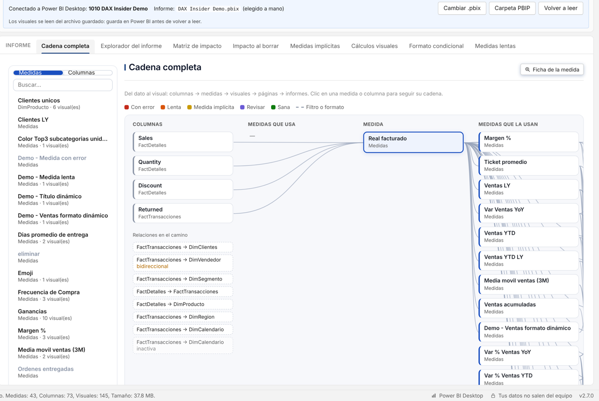
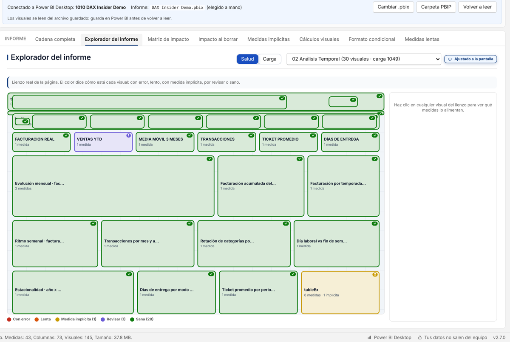
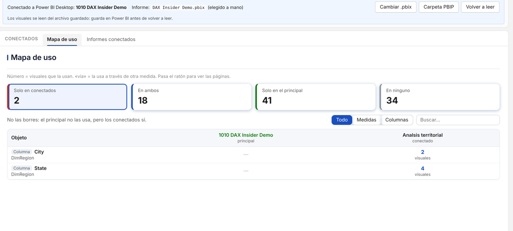
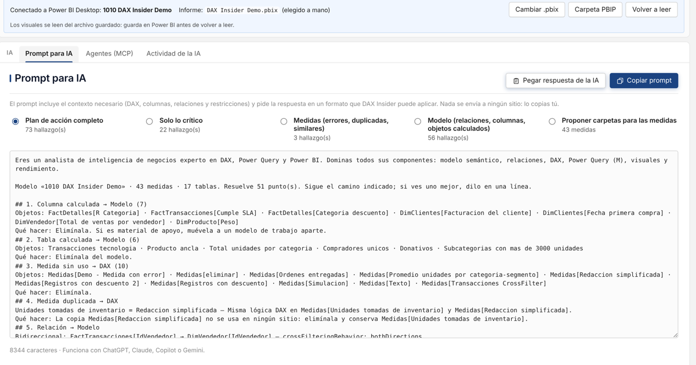

  

<h1 align="center">DAX Insider</h1>

<b>Conectando DAX + Modelo semántico y la capa visual</b>

  <a href="https://github.com/gilvardperez/DaxInsider/releases/latest"><b>⬇ Descargar la última versión</b></a>
  &nbsp;·&nbsp; Windows 10/11 (64 bits) &nbsp;·&nbsp; Portable, sin instalar

---

DAX Insider revisa tu modelo de Power BI de punta a punta: las medidas DAX, el modelo semántico y los visuales del informe. Te dice qué conviene corregir, por qué y qué se rompe si lo cambias. Además, puede aplicar las correcciones en Power BI Desktop, con respaldo y Deshacer.

## Descarga y uso

1. Entra a **[Releases](https://github.com/gilvardperez/DaxInsider/releases/latest)** y descarga `DAX-Insider-x.y.z-portable.zip`.
2. Descomprímelo en la carpeta que quieras (por ejemplo, `Documentos\DAX Insider`).
3. Doble clic en **DAX Insider.exe**. No hay que instalar nada ni crear una cuenta.

> **Aviso de Windows:** el .exe todavía no tiene firma digital. La primera vez SmartScreen puede mostrar «Windows protegió su PC»: pulsa **Más información › Ejecutar de todas formas**. Si Windows lo bloquea sin esa opción, haz clic derecho en el .zip › **Propiedades** › marca **Desbloquear** antes de descomprimir.

Para analizar un informe, ábrelo en **Power BI Desktop** y entra a **Herramientas externas › DAX Insider**. La primera vez, la app te ofrece registrar ese botón. Sin Power BI abierto, usa **Abrir PBIP**.

### La carpeta es la app

DAX Insider guarda todo junto al programa, en la carpeta **`DAX Insider Data`**: proyectos analizados, historial de salud, historial de cambios, respaldos del modelo (.bim) y decisiones (hallazgos ignorados, informes conectados).

- Para llevarlo a otra PC o hacer una copia, copia la carpeta completa.
- Si la carpeta no permite escribir (por ejemplo, `Archivos de programa`), los datos se guardan en `%LOCALAPPDATA%\DAX Insider\Data`.
- Para actualizar, reemplaza solo `DAX Insider.exe`: tus datos se quedan.

## Qué hace

| Sección | Qué encuentras |
|---|---|
| **Resumen** | Salud del modelo (0–100) explicada punto por punto, plan de acción por impacto y esfuerzo, e historial de salud. |
| **Modelo** | Peso en memoria (VertiPaq), relaciones, integridad referencial, ficha de cada medida, duplicadas y similares, linaje, objetos calculados, columnas sin uso y seguridad (RLS). |
| **Informe** | Cadena completa (columna → medida → visual → página), explorador del lienzo con capa de salud, matriz e impacto al borrar, medidas implícitas, cálculos visuales, formato condicional y medidas lentas. |
| **Conectados** | Informes que usan el mismo modelo: qué usa el principal, qué usan los demás y qué no usa nadie. |
| **Hallazgos** | Todo lo que conviene corregir en una lista, con **Aplicar**, **Copiar prompt** e **Ignorar**. |
| **IA** | Prompts cortos con el camino y el contexto exacto, y modo **MCP** para Claude, Copilot y otros agentes (tú confirmas cada cambio). |
| **Herramientas** | Historial de cambios con Deshacer e informe para compartir (PDF o HTML). |

  
  

  
  

  
  

  

**Aplicar cambios con seguridad:** antes de tocar el modelo, DAX Insider muestra la lista de cambios, guarda un respaldo completo (.bim) y aplica todo o nada. Cada cambio se puede deshacer. Nunca borra una tabla que guarda medidas ni algo que use un visual, un filtro, un fx o un informe conectado.

## Privacidad

- Tus modelos **no salen de tu computadora**. No hay cuentas, servidores ni telemetría.
- Lo único que se conecta a internet es el aviso de nueva versión, que consulta este repositorio sin enviar datos. Se desactiva en Configuración.
- Los prompts para IA no se envían solos: tú los copias y los pegas, o tu agente MCP los pide en tu equipo.

## Comentarios

¿Algo no funcionó, o se te ocurre una mejora? Abre un **[Issue](https://github.com/gilvardperez/DaxInsider/issues)** y cuenta qué hiciste, qué esperabas y qué pasó. Si fue un error al analizar, ayuda adjuntar el archivo `dax-insider.log` de `%LOCALAPPDATA%\DAX Insider` (trae nombres de archivos y del modelo, pero no los datos).

## Requisitos

- Windows 10 u 11 de 64 bits.
- Power BI Desktop (Microsoft Store o instalador) para analizar informes abiertos y aplicar cambios.

## Autor

Creado por **[Gilvard Pérez](https://www.linkedin.com/in/gilvardperez/)** · Comunidad **[Club Power BI](https://www.skool.com/club-power-bi-9524/about)**

---

### English

**DAX Insider** checks your Power BI model end to end (DAX measures, semantic model and report visuals), explains what to fix and what would break, and can apply the fixes in Power BI Desktop with a full backup and Undo. It's a portable Windows app: download the zip from **[Releases](https://github.com/gilvardperez/DaxInsider/releases/latest)**, unzip it anywhere and run `DAX Insider.exe`. Everything it saves stays in the `DAX Insider Data` folder next to it. Switch the interface to English in **Settings › Idioma · Language**. Your models never leave your computer.

---

© 2026 Gilvard Pérez. Todos los derechos reservados. El uso de DAX Insider es gratuito; el código fuente no se distribuye. Ver [LICENSE](LICENSE.md).
